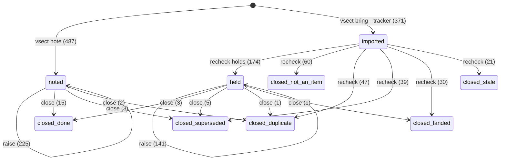
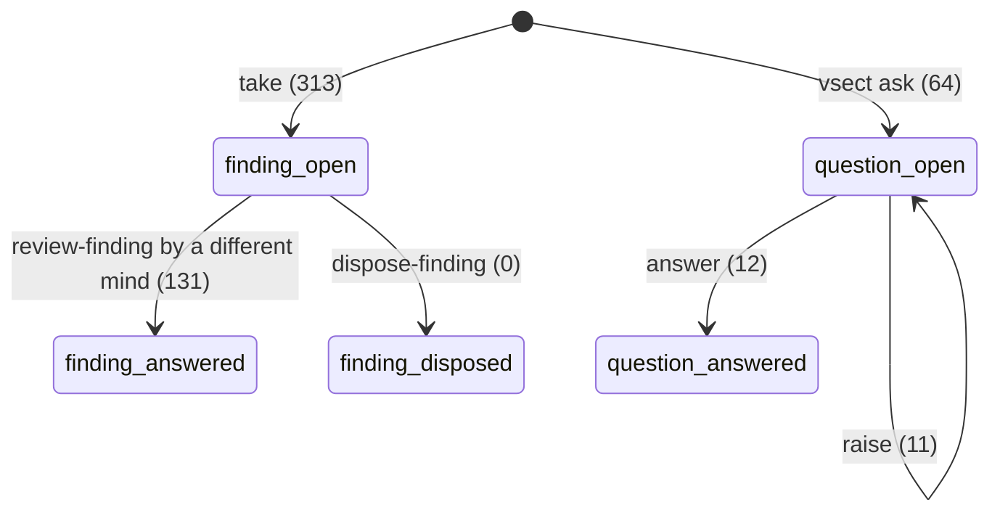
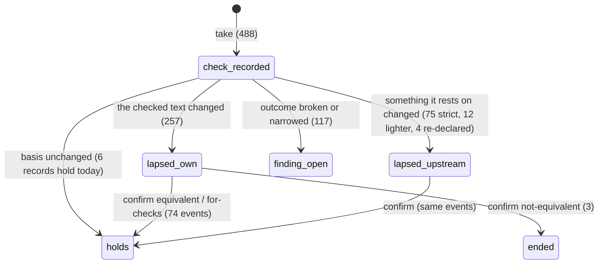
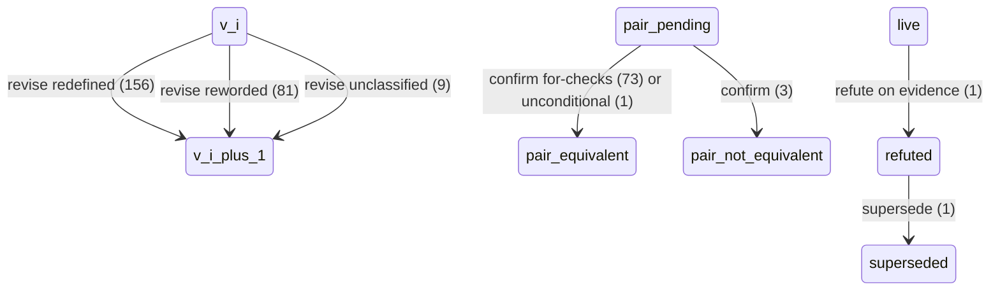

**KR I.3 / I.4.** Part of `README.md`'s set; read that first.

# The kinds, and how things flow through them

## 1. Kinds as declared, kinds as used

`.vsect/kinds.yaml` declares four record kinds at record grain: `segment` (246 live, under the four `src/` dirs), `review` (64), `question` (64) and `item` (858, of which 197 under `items/imported/`). vsect's built-in `decision` and `purpose` kinds exist and hold nothing: zero decisions have been recorded, in a sprint whose retrospective lists twelve process corrections.

The kinds are containers. The flows are the acts, and the trail names them. 2,259 events at `2aa995e5`:

| On | Act | Count | What it is |
|---|---|---|---|
| segment | `revise` | 246 | an edit taken in (156 redefined, 81 reworded, 9 unclassified), on 109 segments |
| segment | `rederive` / `read-check` / `run` / `instantiate` / `read` | 269 / 122 / 88 / 4 / 5 | a check, bound to the basis it read |
| segment | `place-finding` | 309 | a finding opened on the segment (313 in all; 3 on items, 1 on a review) |
| segment | `review-finding` | 131 | a finding confirmed answered, always by someone other than its placer |
| segment | `confirm-rewording` | 77 | a second mind re-binding lapsed checks (74 equivalent, 3 not) |
| segment | `correct` | 90 | an actor correcting the record of its own act (135 in all) |
| segment | `refute` / `supersede` | 1 / 1 | the F72 ceiling |
| item | `recheck` | 374 | an imported tracker line judged against HEAD |
| item | `raise` | 371 | an existing item found again (387 in all, on 244 distinct items) |
| item | `close` | 29 | 18 done, 8 superseded, 3 duplicate |
| question | `answer` | 12 | of 64 asked |
| review | `take` | 65 | 500 checks and 200 findings taken from 64 reviews |

Acts the design names that the trail never shows: `assert`, `decline`, `dispose-finding`, `retire`, `mint`, `split`, `merge`, `rename`, `narrow`, `contest`, `cross`, `brief`, `decide`, `era`. `ask`, `note` and `bring` write only files, by design, so an item's or question's birth is a git fact, not an event.

## 2. The state machine, read off the trail

`scripts/fsm.py` walks the events in time order and counts every state change. Mermaid below; the counts are the whole sprint plus the two days since.

### Items

Stocks today: noted-open 467, held-open 164, closed 227 (not-an-item 60, duplicate 50, superseded 47, landed 31, stale 21, done 18). Of 858 items, 18 reached `done`: two percent. The ledger is an intake so far, not a throughput; that is expected two days in, and it is also the number to watch.

Transition frequencies worth holding: an imported tracker line survived re-check 47% of the time (174 of 371), and by source file the survival ran from TODO.md's 8 of 10 in the pilot down to PRACTICA's 1 of 2 and the proposal files' index rows at zero. A drain's finding was already in the ledger 47% of the time (377 raises against 428 items drains opened). Eight raises landed on items already closed.

### Findings, questions, checks

Open findings 182, answered 131. No finding has ever been disposed of as rejected or known-defect: the only exit is a revision confirmed by a second mind, so a wrong finding and a right one wait in the same queue. Questions: 61 of 64 name `anyone` as closer; one names the steward; two name awaited work.

Checks recorded 488; 94 records carry one; 6 of those hold now. The lapses split 257 own-text to 75 upstream: the rounds re-edited the text that had just been checked, which is the loop in `03-loops.md`.

### Segment versions

Sources into the whole system: `note` 487, `bring` 371, `take` (313 findings, 488 checks), `ask` 64, `revise` 246. Sinks reached: `done` 18, `answered` 131 findings, `answered` 12 questions, `superseded` 1 segment, closed-by-recheck 197. Everything else is stock. The dashboard's "Waiting" block is the stock view of this same graph; the diagram adds the edges and their rates, which is what `vsect flows` would print (`06-recommendations.md` §7).

## 3. Documents that carry two flows

**`reviews/`.** 31 of 64 reviews are an integrator's own record of what it landed ("these checks are the reviser's own; the KR asks for an independent verifier after this"); 33 are a different mind's check. Both are `kind: review`, both yield `rederive` events on the derivation line, and the dashboard counts them alike. They are different acts. Integrator-recorded re-derivations: 116, all confirmed. Independent: 153, of which 65 broke or narrowed something. The design has an `assert` act at the lowest rung for exactly the first case; it was not built, so the author's own landing record wears the independent check's clothes.

**`items/`.** Three populations share the directory: items opened by a mind with a judgment (`note`, 487), tracker lines re-checked as real (`provenance: imported`, with `rechecked:` and sometimes `restated:` in frontmatter, 174), and 29 closed items whose frontmatter carries a `closed:` line. A reader of the directory sees one kind; `vsect open` sorts them out.

**`items/imported/`.** 197 files, all closed by a `recheck` event; 8 say so in their frontmatter and 189 do not. Cause, verified in git: `recheck` writes the event and rewrites the file's frontmatter (`verbs.rs` `mark_closed`), and prints both paths to commit. For 190 of the 196 non-`holds` re-checks, the commit that added the event file touched no item file; for 172 of 176 `holds`, it did, because `holds` moves the file into `items/` and the move cannot be left out. The lanes committed the event paths and dropped the frontmatter rewrites. `vsect check` reports "Structure: clean" because it has no rule that compares a file's `closed:` line with the trail. The design says frontmatter never holds computed values (`core.md` §10.2); the implementation writes `closed:`, `rechecked:` and `owner:` there, and the one departure from that rule is where the drift sits.

**`vsect open`.** The most-read surface prints "1926 open item(s)". Distinct things: 1,213. The 631 open items appear 1,320 times because the list is keyed by what an item concerns and an item concerning three segments prints three times; the 52 questions print 76 times for the same reason. And the five row kinds (item, finding, question, lapsed check, upstream-unread) are all called "open items" in the header. The number an arriving agent sees first is 1.6x the number of things and mixes work owed with a check that wants a second mind.

**`CHANGELOG.md`, commit bodies, the retrospective.** The sprint's decisions (integrator continuity; one check per landing then back to the author; retirement is part of landing) live in prose in reflection 31 and in INTENT's status lines. The built-in `decision` kind holds zero records, so a decision is not something `vsect open` or `why` can show, and the lead's first item on return (`2aa995e5`) is that INTENT's status lines lag the record.

## 4. Out of sync, with causes

Each verified at `2aa995e5`.

1. **189 imported items closed in the record, open in their files.** Commit seam, above. Repair is a `vsect check` rule plus an idempotent rewrite from the trail; neither needs a mind.
2. **17 of 18 `close --by-commit` citations name commits no ref reaches.** `close` checks that the commit exists locally (`git cat-file -e`) and not that the durable ref carries it; the lanes closed items from worktree branches whose commits were later rebased, so the hash in the event is of a commit that was never on main. The work is on main under another hash; the citation is dead. The tool already solves this class for text versions (`vsect anchors`, durable-ref reachability) and not for commits.
3. **The dashboard's "Known broken" register for `narrowed`.** Reflection 31 item 11; still true: `scope-adaptive-system` and `def-observation-function` show as broken on two wording findings whose check's verdict was that the scope holds up.
4. **A `## Claim Record` insertion lapses every downstream derivation check.** The lead's observation, confirmed in `record.rs` (the hashed text is the body minus `## Working Notes` only) and in the confirm pass (13 of 36 lapsed pairs were pure record insertions). At record grain this is what "one fate" means; the remedy is grain (carving, or a sidecar the build folds in), not a normalizer exception.
5. **INTENT's I.4 status says 148 rewordings / 247 lapsed; the dashboard says 223 / 336.** The lead has filed this.
6. **110 of 661 held items carry no `concerns:`.** They are invisible to `vsect open segment:<slug>` and to I.3's test ("what is open about `#def-strategy-dag` is one grep"). 105 item rows in `vsect open` target "(the store)".
7. **85 open items name no KR** (dashboard), and the owner field holds 20 distinct free-text forms that are not KR ids ("F.2 / F.3 (…)", "unassigned (C.2-adjacent; see C1 spike)"). `check_owner` exists in the tool; the data shows it was not applied to `note` at the time these were written.
8. **The drain dispositions are prose.** 23 files under `drain/` carry roughly 2,700 per-source verdicts in bolded headings (`LEDGER` / `ASIDE` / `DEFECT` / `PED.` in `audits.md`; "Already in canon" / "Set aside" / "True join not in canon" in the influx drains; "To `.integrated/`" / "Stay live" in `spikes.md`). None is an event. I.10 measured the consequence: 60% of the ledger's coverage of claims is named only there.
9. **Self-recorded and independent checks are one count.** Not a file-vs-record disagreement but a projection the store never declared and the dashboard prints anyway: "derivation confirmed 262" is 151 integrator plus 111 independent.
