**KR I.3 / I.4 (and I.8, I.9).** Part of `README.md`'s set.

# Retiring cruft: the flow that exists and the one that does not

Joseph's question: what is the flow for removing and sunsetting cruft, including marking which part of the influx was adjudicated as already superseded, which part became initial findings that are not yet changes to claims, and what each thing's final disposition is.

## What exists today, per kind

| Kind | Terminal states the tool records | Used |
|---|---|---|
| imported item | `landed`, `stale`, `superseded`, `duplicate --of`, `not-an-item` (via `recheck`), or `holds` → a live item | 197 closed, 174 held |
| item | `done --by-commit`, `moot`, `superseded`, `duplicate --of` | 29 |
| finding | `answered` (by a second mind's `review-finding`); `rejected` / `known-defect` (via `findings --dispose`) | 131; 0 |
| question | `answered` | 12 |
| segment | `refute` → `supersede` or `retire` | 1 refuted, 1 superseded, 0 retired |
| check | lapses by itself; `confirm` re-binds; `not-equivalent` ends it | 336 lapsed, 77 confirmed, 3 ended |

So for items and findings the sunset flow is built and the vocabulary is close to right. Two gaps inside it: a finding cannot be rejected in practice (the verb exists, nobody has used it, and the dashboard counts every open finding as owed), and `close --by-commit` accepts a commit the durable ref does not carry (17 of 18 today), so "closed by the commit that did it" points at nothing a reader can open.

## What does not exist: a record for a source

The design has an influx model (`vsect.md` §3.10; `storage.md`): material is brought with provenance, waits, and each crossing ends *integrated* (where), *rejected*, *needs-review* or *skipped*, recorded by `cross`. None of it was built. The drains therefore wrote the crossing in prose, 23 files, each inventing a vocabulary:

- `audits.md`: **LEDGER** (41), **ASIDE** (33), **DEFECT** (13), **PED.** (3)
- the influx drains: "Already in canon", "Set aside for ASF; home is logos", "True join not in canon (item below)", "Math in canon; application not", "Relayed, not re-read at the primary"
- `spikes.md`: "To `.integrated/`", "To `.archived/`, each with its reason", "Stay live until their items land", "Re-run first-hand", "Not reached"

These are the same five or six states under different words, and they are exactly Joseph's list: *already superseded* (ASIDE, "already in canon"), *initial finding not yet a change to a claim* (LEDGER, DEFECT → an item or a finding), *final disposition* (`.integrated/`, `.archived/`, "set aside, home elsewhere"). The verisectorium theory already states the law that governs the last of these, the delete-test: a source counts as integrated only if, were it deleted, everything it carried is landed elsewhere or disposable.

What the absence costs, measured by I.10: 60% of the ledger's coverage of claims is named only in `drain/`; 94% of the net new places a cold agent must read are the effort's own files; and no spike, audit dir or Working Note moved. The retrospective's item 3 (a record of what was read) and the lead's I.9 finding (the canary never read; "what was not drained cannot be listed") are the same gap from the other side: nothing records that a source was read, by whom, at what version, with what disposition, so neither "what is left" nor "what may be deleted" is a query.

## The disposition machine a source needs

One record per source (a spike file, an audit dir, a Working Note item, an influx file in another repo, a tracker row), `kind: source`, with these states, each a recorded act:

```mermaid
stateDiagram-v2
    [*] --> unread: brought (path, provenance, version)
    unread --> read: read by X at version V
    read --> in_canon: carrier named (segment slug that already holds it)
    read --> superseded: by a named record or result
    read --> set_aside: reason, and home if elsewhere (logos, autopax, pedagogy)
    read --> opened: item or finding id it became
    opened --> landed: the item closed done, or the finding answered
    in_canon --> retired: delete-test passed (every carrier resolves); file moved to .integrated/ or deleted
    superseded --> retired
    set_aside --> retired: moved to .archived/
    landed --> retired
```

Two rules make it checkable rather than narrated:

1. **`retired` is computed, never typed.** A source may leave the live tree when every disposition it carries names a target that resolves (a slug, an item, a finding, a commit on the durable ref). `vsect check` reports a source in `.integrated/` whose carriers do not resolve, which is the delete-test as a lint. Today `.integrated/` is a location-as-label convention that the tool cannot see.
2. **`unread` is the default and is listed.** "What has not been read for integration" becomes `vsect open --kind source --state unread`, and a planted canary is a source whose state the lead can look up rather than remember to check.

The prose dispositions already written are the seed: 2,700 rows with a path, a verdict word and usually a carrier. A one-time import (the `bring --tracker` machinery, with the drain files as the trackers and the bolded verdict as the unit) would carry them into source records before the drain files are deleted, which is the order I.10 says the deletion must take. The import unit matters, as the items-recheck pilot found for trackers: get one drain file right by hand first.

## Spikes and audits as sources, not as a third kind

`spikes/` (64 live entries) and the 24 `AUDIT-WORKING-*` dirs are sources with the same five fates. The spikes SOP's §0a already states their disposition law (knowledge lands self-contained in canon; the artifact goes to `.integrated/` only when its content is verified present, `.archived/` when it has none) and the routing SOP's §3 states the four completion states of a spike. Neither is a record anywhere; both are what a source record would carry. The twelve retrospective corrections include "retirement is part of landing"; a landing that names what it retires is a `cross` event on a source record, and the lead at merge can refuse a landing with none.
